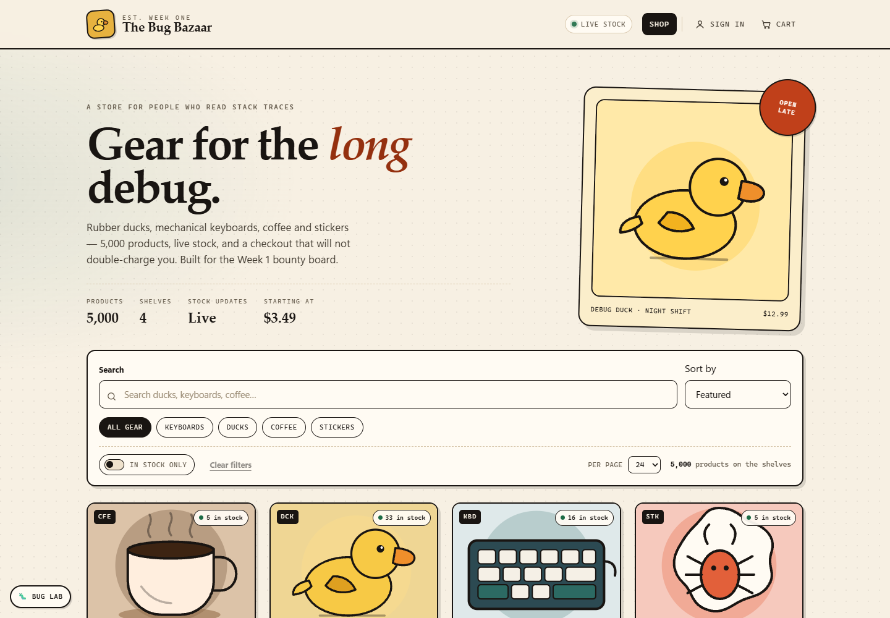
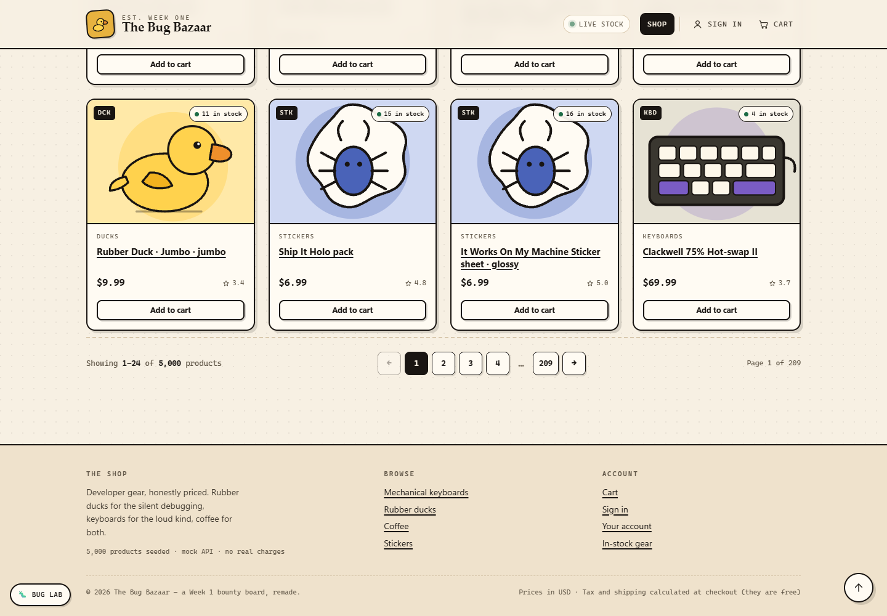

# The Bug Bazaar

A small store for developer gear — rubber ducks, mechanical keyboards, coffee and stickers — built
for the Week 1 Bug Bounty Board brief. React + TypeScript, a 5,000-item mock API, Redux Toolkit for
cart and session, a paginated catalogue (24/48/96 per page) with window virtualization for large
pages, live stock, and 96 tests.



## Quick start

Requires Node 20+ (tested on 22) and npm.

```bash
npm install
npm run dev          # http://localhost:5173
```

That is it — no backend, no Docker, no environment variables. The API is mocked in the browser.

**Demo account:** `demo@bugbazaar.dev` / `bazaar123` (the login page has a **Fill demo credentials**
button).

### Other scripts

| Script               | What it does                                                                     |
| -------------------- | -------------------------------------------------------------------------------- |
| `npm run dev`        | Vite dev server with HMR                                                         |
| `npm run build`      | Strict typecheck + production build to `dist/`                                   |
| `npm run preview`    | Serve the built app on :4173                                                     |
| `npm run typecheck`  | `tsc -b` with both projects                                                      |
| `npm run lint`       | ESLint (type-aware)                                                              |
| `npm run format`     | Prettier write                                                                   |
| `npm test`           | Vitest run (96 tests)                                                            |
| `npm run test:watch` | Vitest watch                                                                     |
| `npm run smoke`      | Playwright drive-through of the purchase flow + screenshots (needs local Chrome) |
| `npm run measure`    | Renders the shelf and prints DOM/time numbers used in `docs/performance.md`      |

`npm run ci` chains lint → typecheck → test → build, the same sequence as GitHub Actions.

## Environment variables

All optional; see [`.env.example`](.env.example).

| Variable                | Default | Purpose                                                                                                            |
| ----------------------- | ------- | ------------------------------------------------------------------------------------------------------------------ |
| `VITE_API_BASE_URL`     | unset   | Unset = in-browser mock. Set = talk to a real backend implementing [`docs/api-contract.md`](docs/api-contract.md). |
| `VITE_ERROR_REPORT_URL` | unset   | POST error-level log events here. Without it they stay in the in-memory buffer.                                    |
| `VITE_ENABLE_DEVTOOLS`  | `false` | Show the dev-only “bug lab” panel in a production build.                                                           |

## What is in the box

| Route           | Screen       | Notes                                                                               |
| --------------- | ------------ | ----------------------------------------------------------------------------------- |
| `/`             | Catalogue    | search, category, in-stock, sort, result count, clear, pagination; state in the URL |
| `/products/:id` | Product      | live stock, quantity cap, related items, back-to-top                                |
| `/cart`         | Cart         | quantities clamped to stock, persisted across reloads                               |
| `/checkout`     | Checkout     | protected; contact validation; 400/409/500 handling; idempotent retry               |
| `/orders/:id`   | Confirmation | protected; status timeline                                                          |
| `/login`        | Sign in      | `?next=` return path, field errors, no double submit                                |
| `/account`      | Account      | session details, sign out                                                           |
| `*`             | Not found    |                                                                                     |

### Pagination

The catalogue loads **24 products per page** by default (48 or 96 from the per-page control), so the
home page is a short page rather than a 5,000-item scroll. `page` and `pageSize` live in the URL
(`?category=coffee&page=2`), any filter change resets to page 1, and the grid still virtualizes at 96
per page.



The **bug lab** (bottom-left, dev only) can force each state: a 500 on the list, a 404 on a product,
401 on login, a 401 that clears the session at checkout, a 409 at checkout (by selling out the item in
your cart), 500 after an order commits, slow network, empty results, out-of-order search, and a socket
drop. That is how every error state is demonstrable without touching code.

### Live stock

A mock socket (`src/realtime/stockSocket.ts`) ticks every 1.3–4 s, focuses on the products on screen,
drops the connection occasionally, and reconnects with exponential backoff (600 ms → 6 s). The header
chip shows `Live stock` / `Reconnecting` / `Stock paused`. The socket closes on unmount; the grid
merges overrides at render so a refetch never loses a tick.

## How it is put together

```
src/
  api/        client (only I/O) + error normalisation
  app/        RTK Query, store factory, persistence, lazy routes
  components/ presentational: card, paginated grid, states, header, toasts
  features/   products (URL filters), cart, auth, realtime, checkout validation
  hooks/      debounce, storage, back-to-top, stock feed, document title
  lib/        cents formatting, logger, error→copy, derived product data
  mocks/      catalogue generator, mutable mock database, route handlers
  pages/      one file per route
  realtime/   MockStockSocket
  styles/     tokens/base → components → pages
  types/      the shared contract in TypeScript
```

- **Server state** lives in RTK Query (cache keyed by query arguments — that is the race-condition
  fix); **client state** in Redux slices; **filters** in the URL.
- **One transport:** components never call `fetch`. `src/api/client.ts` is the only module that does
  I/O, and RTK Query's `baseQuery` calls it.
- **One error shape:** `normalizeError` → `AppError`; screens switch on `kind`, never on a raw
  message. 401 clears the session in one place.
- **Money** is integer cents everywhere, formatted only at render.

More detail, including the data-flow diagram and the three patterns, in
[`docs/ARCHITECTURE.md`](docs/ARCHITECTURE.md).

## Task map

Every numbered task from the brief, and where to find the work.

| ID   | Task                                                    | Where                                                                                                                                  |
| ---- | ------------------------------------------------------- | -------------------------------------------------------------------------------------------------------------------------------------- |
| D1-1 | Setup, formatting, linting, README                      | `package.json`, `tsconfig*.json`, `eslint.config.js`, `.prettierrc`, this file                                                         |
| D1-2 | API contract + mock, 5,000 products, every error        | [`docs/api-contract.md`](docs/api-contract.md), `src/mocks/`, `src/api/client.ts`                                                      |
| D1-3 | TypeScript strict, typed contract, no impossible states | `src/types/domain.ts`, `src/lib/remoteState.ts`, `tsconfig.app.json`                                                                   |
| D1-4 | One data layer                                          | `src/api/client.ts`, `src/app/api.ts`                                                                                                  |
| D2-1 | Product list + details, pagination                      | `src/components/ProductCard.tsx`, `src/components/ProductGrid.tsx`, `src/components/Pagination.tsx`, `src/pages/ProductDetailPage.tsx` |
| D2-2 | Filters + paging in the URL                             | `src/features/products/`, `src/components/FilterBar.tsx`                                                                               |
| D2-3 | Loading / empty / error / success                       | `src/components/StateViews.tsx`, `src/pages/*`                                                                                         |
| D2-4 | Effect cleanup + Back to Top                            | `src/hooks/useBackToTop.ts`, `src/components/BackToTop.tsx`, detail page                                                               |
| D2-5 | Custom hooks                                            | `src/hooks/`                                                                                                                           |
| D2-6 | Race conditions                                         | RTK Query per-argument keys + abort; test in `src/features/products/searchRace.test.tsx`                                               |
| D3-1 | Redux Toolkit, derived cart values                      | `src/features/cart/cartSlice.ts`, `src/components/Header.tsx`                                                                          |
| D3-2 | Cart, stock caps, 409, idempotency                      | `src/pages/CartPage.tsx`, `src/pages/CheckoutPage.tsx`, [`docs/orders.md`](docs/orders.md)                                             |
| D3-3 | Auth, guards, 401, redirect back                        | `src/features/auth/`, `src/pages/LoginPage.tsx`, [`docs/auth.md`](docs/auth.md)                                                        |
| D3-4 | Backend errors → UI                                     | `src/api/errors.ts`, `src/components/StateViews.tsx`, `src/pages/NotFoundPage.tsx`                                                     |
| D3-5 | Caching                                                 | `src/app/api.ts` (`keepUnusedDataFor`, tags)                                                                                           |
| D4-1 | Accessibility                                           | [`docs/accessibility.md`](docs/accessibility.md)                                                                                       |
| D4-2 | Performance measurement                                 | [`docs/performance.md`](docs/performance.md), `scripts/measure.mjs`                                                                    |
| D4-3 | Memoization / virtualization / pagination               | `src/components/ProductGrid.tsx`, `src/pages/HomePage.tsx`, `docs/performance.md`                                                      |
| D4-4 | Live stock                                              | `src/realtime/stockSocket.ts`, `src/hooks/useStockFeed.ts`, `src/features/realtime/`                                                   |
| D4-5 | Tests                                                   | [`docs/testing.md`](docs/testing.md), `src/**/*.test.ts(x)`                                                                            |
| D4-6 | CI                                                      | [`.github/workflows/ci.yml`](.github/workflows/ci.yml)                                                                                 |
| D4-7 | Monitoring                                              | `src/lib/logger.ts`, `src/components/ErrorBoundary.tsx`, [`docs/monitoring.md`](docs/monitoring.md)                                    |
| D5-1 | Architecture                                            | [`docs/ARCHITECTURE.md`](docs/ARCHITECTURE.md)                                                                                         |
| D5-2 | Design patterns                                         | `docs/ARCHITECTURE.md` → Patterns                                                                                                      |
| D5-3 | Queues / order flow                                     | [`docs/orders.md`](docs/orders.md)                                                                                                     |
| D5-4 | Vocabulary                                              | [`docs/glossary.md`](docs/glossary.md)                                                                                                 |
| D5-5 | Architecture review                                     | [`docs/reviews/architecture-review.md`](docs/reviews/architecture-review.md)                                                           |
| D5-6 | Code review                                             | [`docs/reviews/code-review.md`](docs/reviews/code-review.md)                                                                           |
| D5-7 | AI notes                                                | [`docs/ai-notes.md`](docs/ai-notes.md)                                                                                                 |
| D5-8 | Assessment                                              | [`docs/reflection.md`](docs/reflection.md)                                                                                             |
| D5-9 | Submission / walkthrough                                | [`docs/walkthrough.md`](docs/walkthrough.md), CI, this file                                                                            |

Supporting docs: [decisions](docs/decisions.md) (what was chosen, what was not, why) and
[testing](docs/testing.md).

## Testing and CI

```bash
npm test        # 96 tests, ~9 s
npm run lint && npm run typecheck && npm run build
```

CI (GitHub Actions) runs lint → typecheck → test → build on every pull request and on `main`. Enable
branch protection with the **verify** job as a required check and a failing test blocks the merge. An
optional Pages deploy runs on `main` when the repository variable `DEPLOY_PAGES` is `true`.

Behaviour is tested, not implementation: cart math and stock caps, the derived badge, URL filters,
debounce, storage, the full contract (including 409 details and idempotent replay), login double
submit, checkout success, and the 500-after-commit retry. One real-browser smoke script covers the
path jsdom cannot.

## Notes for reviewers

- The mock API is bundled on purpose (there is no server). Pointing `VITE_API_BASE_URL` at a real
  backend skips it; making that a build-time boundary is the recommendation in the architecture
  review.
- The partner review docs are self-reviews, marked as such, because no partner repository was
  available in the submission environment. They follow the required shape and are ready to be
  replaced with a real pairing review.
- Commit messages start with the task ID (`D2-2: …`), so the history can be walked task by task.

## Stack

React 18 · TypeScript 5.6 (strict) · Vite 5 · Redux Toolkit 2 + RTK Query · React Router 6 ·
@tanstack/react-virtual · Vitest 2 + Testing Library · ESLint 9 · Prettier · GitHub Actions.

Artwork is original SVG in `public/img`; no external fonts or images, so the app runs offline.
