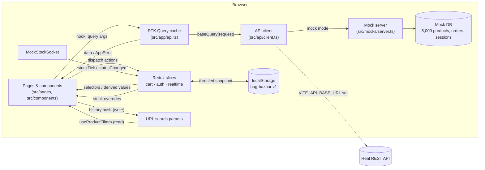

# Architecture

The Bug Bazaar is a client-only React application with a mock API inside the bundle. The interesting
part is not the file count; it is the three boundaries that keep it maintainable:

1. **One transport.** Components never call `fetch`. Every request goes through
   `src/api/client.ts` and then RTK Query.
2. **One state owner per fact.** Server data, client state and filter state each live in exactly one
   place (see the table below).
3. **One error shape.** The transport normalises everything into `AppError`; screens switch on
   `kind`, not on raw HTTP.

## Folder structure

```
bounty-app/
├─ .github/workflows/ci.yml        lint → typecheck → test → build
├─ docs/                          written tasks, reviews, measurements
├─ public/img/                    category artwork (SVG, offline)
├─ scripts/
│  ├─ capture.mjs                 Playwright smoke + screenshots
│  └─ measure.mjs                 list render measurements
└─ src/
   ├─ api/
   │  ├─ client.ts                the only module that talks to a network/mock
   │  └─ errors.ts                HttpError, normalizeError, user-facing copy
   ├─ app/
   │  ├─ api.ts                   RTK Query: baseQuery + endpoints + tags
   │  ├─ store.ts                 store factory, hydration, persistence wiring
   │  ├─ persist.ts               localStorage snapshot (cart + session)
   │  ├─ hooks.ts                 typed useAppDispatch / useAppSelector
   │  └─ App.tsx                  lazy routes
   ├─ components/                 presentational: card, grid, header, states, toasts
   ├─ features/
   │  ├─ products/                filter model + URL hook
   │  ├─ cart/                    cart slice, derived selectors
   │  ├─ auth/                    auth slice, guard, safe redirects
   │  ├─ realtime/                live stock overrides + socket status
   │  └─ checkout/                client-side contact validation
   ├─ hooks/                      reusable typed hooks (debounce, storage, scroll, feed)
   ├─ lib/                        formatting, logger, error→copy, derived product data
   ├─ mocks/                      catalogue generator, mutable "server" db, route handlers
   ├─ pages/                      one file per route
   ├─ realtime/                   MockStockSocket (stands in for a WebSocket)
   ├─ styles/                     tokens/base, components, pages
   ├─ test/                       setup + render helper
   └─ types/domain.ts             the shared contract in TypeScript
```

## Data flow



A request, end to end:

1. A page calls `useGetProductsQuery({ search, category, … })`.
2. RTK Query keys the cache by that argument object. A new search is a **different cache entry**, so a
   late response for the old search can only write to the old entry.
3. `baseQuery` reads the token from the auth slice and calls `client.request`.
4. In mock mode the client routes to `handleMockRequest`, which applies artificial latency, filters
   the in-memory catalogue, and can be told to fail. Responses are deep-cloned so the mock database
   and the cache never share objects.
5. Success becomes `{ data }`; failure is normalised to `AppError`, and a 401 dispatches
   `sessionExpired()` once.
6. `toRemoteState()` turns the hook's flags into a discriminated union (`idle | loading | error |
success`), which the page switches on. There is no `isLoading && error` state to style.

## Where each kind of state lives

| State               | Owner           | Example                                                               | Why there                                                                                |
| ------------------- | --------------- | --------------------------------------------------------------------- | ---------------------------------------------------------------------------------------- |
| **Server**          | RTK Query cache | product list, product, order, `/me`                                   | It is not ours. Cache + tags + abort come free; refetching is explicit.                  |
| **Client / global** | Redux slices    | cart lines, token + user, live stock overrides, socket status         | Needed by distant components (header badge, cart, checkout) and must survive navigation. |
| **Client / local**  | `useState`      | search draft, quantity on a detail page, form fields, bug-lab panel   | Only one component cares. Putting it in Redux would add actions nobody else calls.       |
| **URL**             | search params   | `search`, `category`, `inStock`, `sort`, `page`, `pageSize`, `?next=` | Shareable, refresh-safe, and the Back button is a feature rather than a bug.             |
| **Persistent**      | `localStorage`  | cart, session                                                         | Survives a reload; the trade-off is documented in [`auth.md`](./auth.md).                |

Rules that follow from the table:

- The header cart badge is a **derived selector** (`selectCartCount`), never a stored number.
- The mock socket never writes product objects into the cache; it writes overrides into the realtime
  slice and the grid merges them at render. A refetch therefore cannot erase a live update.
- Filters are read from the URL by `useProductFilters`; no component keeps a second copy except the
  input's draft, which is deliberately local while you type.
- Paging is URL state too. `HomePage` asks the API for `page` + `pageSize`, and the only pages that
  exist in memory are the 24–96 products of the current page (plus anything the cache already holds).

## Patterns

### 1. Container and presentational components

- **Presentational:** `components/ProductCard.tsx` takes `product` + `onAdd` and renders. It does not
  fetch, dispatch or read the store — which is what makes it memoizable and trivially testable.
  `components/StateViews.tsx` is the same idea for loading/empty/error panels.
- **Container:** `pages/HomePage.tsx` owns the query, the cart dispatch, the toast and the grid. It
  passes data down and receives events up.
- **Why:** one place per concern. When the card design changes, no data code moves; when the API
  changes, no card changes.

### 2. Custom hooks

| Hook                             | Replaces                                                                                  |
| -------------------------------- | ----------------------------------------------------------------------------------------- |
| `useProductFilters`              | every component reading/writing `useSearchParams` by hand                                 |
| `useDebouncedValue`              | a timer ref repeated in the search box                                                    |
| `useLocalStorageState`           | copy-pasted read/write/`storage`-listener code (used by the bug lab / future preferences) |
| `useBackToTop`                   | a scroll listener that three pages would otherwise duplicate                              |
| `useStockFeed` / `useStockFocus` | socket wiring and focus bookkeeping                                                       |
| `useDocumentTitle`               | per-page `document.title` effects                                                         |

Each is typed, returns the smallest possible surface, and cleans up after itself. The two storage
hooks are covered by tests; the socket hook is covered by the store's status tests.

### 3. Adapter

Three adapters, all one-directional and all tested:

- **Transport adapter** — `normalizeError()` in `src/api/errors.ts` converts `HttpError`, aborts and
  unknown throws into one `AppError`. UI code never sees a `Response`.
- **Cache-state adapter** — `toRemoteState()` in `src/lib/remoteState.ts` converts RTK Query's flag
  bag into a discriminated union, so impossible UI states cannot be constructed.
- **Socket adapter** — `realtime/stockSocket.ts` exposes `connect / close / subscribe / setFocus`,
  the same lifecycle a browser `WebSocket` has. Replacing it with `new WebSocket(url)` is a one-file
  change; nothing above it knows the feed is fake.

### Pattern inventory

| Pattern                    | Where it is used                                                                                                                                                                        | Why there                                                                                                                                    | What it costs                                                                                                                     |
| -------------------------- | --------------------------------------------------------------------------------------------------------------------------------------------------------------------------------------- | -------------------------------------------------------------------------------------------------------------------------------------------- | --------------------------------------------------------------------------------------------------------------------------------- |
| Container / presentational | `pages/HomePage.tsx` (container) → `components/ProductGrid.tsx` → `components/ProductCard.tsx` (presentational). Same split in `pages/CartPage.tsx` → `components/QuantityStepper.tsx`. | The card needs to be memoizable and testable without a store; the page owns fetching, dispatch and toasts.                                   | One extra prop (`onAdd`) to thread through the grid; the grid must not grow fetching responsibilities.                            |
| Custom hooks               | `features/products/useProductFilters.ts`, `hooks/useDebouncedValue.ts`, `hooks/useLocalStorageState.ts`, `hooks/useBackToTop.ts`, `hooks/useStockFeed.ts`, `hooks/useDocumentTitle.ts`  | Browser APIs and URL history are stateful and easy to leak. Each hook owns one subscription and its cleanup, so components stay declarative. | Hooks hide control flow: a reader must open the hook to see when the listener is added. Mitigated by one-hook-one-file and tests. |
| Adapter                    | `api/errors.ts` (`normalizeError`), `lib/remoteState.ts` (`toRemoteState`), `realtime/stockSocket.ts` (socket facade)                                                                   | Each converts a foreign shape (HTTP, RTK Query flags, socket events) into the one shape the UI already understands.                          | An extra layer in stack traces; worth it because error and state copy live in one place.                                          |

## Error and loading model

```ts
type RemoteState<T> =
  | { status: 'idle' }
  | { status: 'loading' }
  | { status: 'error'; error: AppError }
  | { status: 'success'; data: T };
```

`AppError.kind` drives copy, not the raw message:

| kind           | Screen behaviour                                                 |
| -------------- | ---------------------------------------------------------------- |
| `bad_request`  | field errors beside inputs, first invalid field focused          |
| `unauthorized` | session cleared, redirect to login with `?next=`                 |
| `not_found`    | Not Found panel / 404 page, never a stack trace                  |
| `conflict`     | names the product that ran out, links back to the cart           |
| `server`       | retry affordance; checkout retries with the same idempotency key |
| `network`      | retry, explains the connection                                   |

Server `message` strings are for logs only. The one exception is field-level `details`, which are
written to be read by a person and are rendered next to their field.

## Boundaries and how to change them

- **Add a page:** create `src/pages/X.tsx`, add a lazy route in `src/app/App.tsx`, wrap in
  `RequireAuth` if it needs a session. No store changes.
- **Add an endpoint:** add a builder to `src/app/api.ts` and a route to `src/mocks/server.ts`; add
  tags if it can invalidate product data. Put the shape in `types/domain.ts` and the doc row in
  `api-contract.md`.
- **Replace the mock:** set `VITE_API_BASE_URL`. The client's mock branch is skipped; the mock
  modules stop being reachable (and can be deleted).
- **Replace the live feed:** reimplement `StockSocket` with a real WebSocket, keep the
  `StockTick`/`SocketStatus` contract, keep `useStockFeed`.

## One choice to defend

**RTK Query instead of TanStack Query.** The brief already mandates Redux Toolkit for cart and
session, so RTK Query removes a dependency and lets both caches share one store, one middleware chain
and one devtools timeline. More importantly, keying cache entries by argument is the race-condition
fix: the latest search is the only entry the screen reads, and unsubscribing aborts the request in
flight. TanStack Query would solve it equally well, but then the app would run two state systems
side by side for no gain. The cost is RTK Query's smaller ecosystem and its slightly opaque lifecycle
(`isLoading` vs `isFetching`), which is why `toRemoteState` exists as the one adapter everyone uses.
