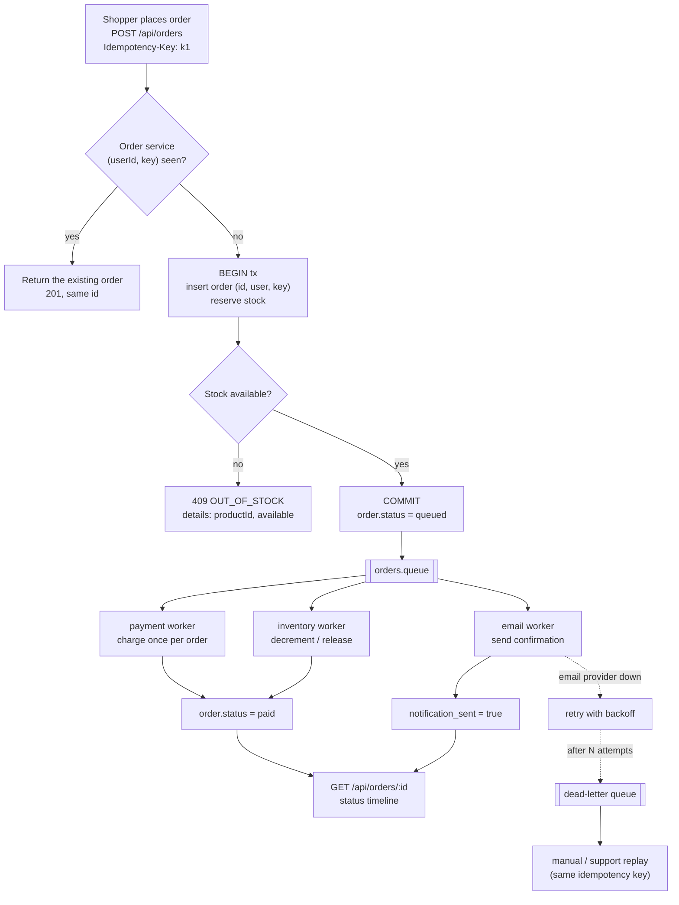

# Orders, queues and why a retry cannot double-charge

This file describes the order flow as a production system would run it, and maps each claim back to
what this repository actually implements.

## The flow in one picture

## Why a queue

An order touches inventory, payment and email. Doing all three inside the HTTP request makes the
request as slow and as fragile as the slowest dependency, and a timeout leaves the client unsure
whether the order exists. A queue buys three things:

1. **Latency** — the request only writes the order and reserves stock, so checkout responds in
   milliseconds instead of waiting on a payment provider.
2. **Retries without duplicates** — a worker can retry a job, because every consumer uses the order
   id as its idempotency key. Processing the same job twice is a no-op.
3. **Independent failure** — email being down does not stop payment or inventory; those complete and
   the notification retries later.

Trade-off: the shopper sees `queued`, not `paid`, immediately, and the system has to model that
in-between state honestly. That is why the confirmation page shows a three-step timeline and why the
API returns `status`, not a boolean.

## What happens if email is down

`email` is the least important worker, so it is isolated:

- The order is already `paid`/`queued`; the email job fails and is retried with exponential backoff
  (e.g. 1 s, 10 s, 1 min, 10 min).
- After a configured number of attempts it moves to a dead-letter queue with the order id and the
  attempt history.
- Replaying from the DLQ uses the same order id as the idempotency key, so a customer can never get
  two confirmations for one order, and a support agent can trigger a resend safely.
- If the customer needs the confirmation now, the order page is the source of truth; email is a
  notification, not the record.

## How this prevents double charges (D3-2)

The client sends an `idempotencyKey` with every checkout attempt. Three layers make a retry safe:

**1. A key scoped to the cart, not to the click.**
`CheckoutPage` creates a key when the cart contents (product ids + quantities) change, and keeps it
across retries of the same attempt. Two intentional identical orders get two keys; a retry of one
order gets one key. A key per click would defeat the purpose, and hashing the cart would merge two
separate orders of the same thing.

**2. A unique constraint inside the transaction.**
The order service stores `(userId, idempotencyKey)` with a unique index and inserts it in the same
transaction as the order. The second request hits the constraint, reads the existing order and
returns it. That is a single atomic decision — no “check then insert” race.

**3. A worker that is idempotent by order id.**
The payment worker charges using the order id as its provider-side idempotency key, so even if the
job runs twice (at-least-once delivery), the provider settles once.

What the repository implements, and the test that proves it:

| Claim                                                 | Code                                                      | Test                                                              |
| ----------------------------------------------------- | --------------------------------------------------------- | ----------------------------------------------------------------- |
| Key is stable per cart, renewed when the cart changes | `CheckoutPage` `keyRef` + effect on `selectCartSignature` | `cartSlice.test.ts` — signature changes with quantity             |
| Server stores `(user, key) → order` and replays it    | `src/mocks/server.ts` `orderIdByKey`                      | `mockServer.test.ts` — “never duplicates on retry”                |
| A retry after a lost 500 returns the first order      | `failOrdersAfterCommit` path                              | `CheckoutPage.test.tsx` — “retries with the same idempotency key” |
| Two submits in one tick create one order              | disabled button + `isLoading` guard + server key          | `CheckoutPage.test.tsx` — two `submit` events                     |
| 409 names the item that ran out                       | `details.productId` → banner                              | `CheckoutPage.test.tsx` — “names the item”                        |
| Stock is re-checked server-side                       | `requested` map vs `product.stock`                        | `mockServer.test.ts` — 409 details                                |

## Edge cases and the answer

| Case                                     | Behaviour                                                                                                                                                                                             |
| ---------------------------------------- | ----------------------------------------------------------------------------------------------------------------------------------------------------------------------------------------------------- |
| Response lost after commit               | Client keeps the key, retries, receives the same order.                                                                                                                                               |
| Two tabs submit the same cart            | Different keys (each tab creates its own), so two orders _can_ be created — matching two explicit clicks. If this is not wanted, scope the key to the cart in `sessionStorage` so both tabs share it. |
| Stock runs out between cart and checkout | 409 with the product; cart is kept and the banner links back.                                                                                                                                         |
| Customer edits the cart after a failure  | Signature changes → new key → a genuinely new order, which is correct.                                                                                                                                |
| Worker crashes mid-payment               | Job is redelivered; the provider idempotency key makes the charge a no-op.                                                                                                                            |
| Order service times out before commit    | Nothing was written; a retry creates one order.                                                                                                                                                       |

## Status model

`queued → packing → shipped` is what the UI shows. In a real system there is also `payment_failed`
and `cancelled`; the confirmation timeline maps them to a failed step rather than pretending the
order is progressing. The mock only emits `queued`, and the timeline still renders all three steps so
the shape of the real thing is visible.
